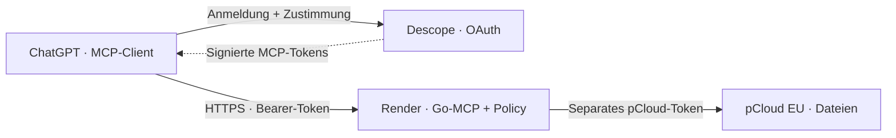

<div align="center">

# ☁️ pcloud-mcp

**Deine pCloud. Dein KI-Assistent. Kontrollierter Zugriff.**

Ein MCP-Server in Go, der ChatGPT mit dem eigenen pCloud-Konto verbindet —
mit OAuth-Anmeldung, serverseitiger Besitzerprüfung und klaren Zugriffsgrenzen.

[](https://github.com/cyrano-janus/pcloud-mcp/actions/workflows/ci.yml)
[](go.mod)
[](https://github.com/modelcontextprotocol/go-sdk)
[](SPEC.md)
[](#aktueller-stand)

[Status](#aktueller-stand) · [Dienste](#verwendete-dienste) · [Tools](#funktionen) · [Lokal starten](#lokal-starten) · [Dokumentation](#dokumentation)

</div>

---

## Aktueller Stand

**Geprüft am 13. Oktober 2026:** Der geschützte Lesezugriff funktioniert in ChatGPT.
Der Dienst läuft auf **Render Free in Frankfurt**, mit pCloud in der **EU-Region**.

| Bereich | Stand |
| --- | --- |
| ChatGPT-Anmeldung | Descope-OAuth eingerichtet; reale MCP-Aufrufe erfolgreich |
| Konto und Credentials | Reales pCloud-Konto bestätigt; verschlüsseltes Zugangspaket geprüft |
| Ordner und Metadaten | `whoami`, `list_folder` und `get_file_info` live geprüft |
| Erlaubter Stammordner | **Kontowurzel**, ausdrücklich mit `PCLOUD_ROOT_FOLDER_ID=0` freigegeben; Root-Aufruf erfolgreich |
| Öffentlicher Endpunkt | HTTPS + Streamable HTTP; ohne gültiges Token **401** |
| Schreiben | **Deaktiviert** im gehosteten Dienst |
| pCloud-Einrichtung | Abgeschlossen und abgeschaltet; `/setup/pcloud` liefert 503 |
| Release | **0.3.0-rc.1**, Spezifikation **1.0** verbindlich; Software-Abnahme noch offen |

Eine frühere Abnahme war auf `mcp-test` begrenzt und verweigerte die Kontowurzel.
Anschließend wurde die Kontowurzel auf ausdrücklichen Betreiberwunsch freigegeben
und mit einem echten MCP-Aufruf geprüft. Die Bindung an genau einen Besitzer
bleibt erhalten; fremde oder nicht eigene Objekte werden weiterhin geprüft.

**Noch offen:** reale Abnahme von Suche und Textlesen, Token-Refresh, Widerruf,
Schlüsselrotation und Claude-Interoperabilität. Die [SPEC v1.0](SPEC.md) legt das Leseprodukt verbindlich fest. Die Software
bleibt bis zum vollständigen Release-Gate ein Release Candidate. Bilder wurden als Metadaten aufgelistet,
aber nicht heruntergeladen oder analysiert.

## Verwendete Dienste

| Dienst | Aufgabe im Projekt | Tatsächlich verwendet |
| --- | --- | --- |
| [pCloud](https://www.pcloud.com/) | Dateispeicher und Anbieter-API | EU-Konto; eigene OAuth-App `Ppcloud-mcp-cyrano` |
| [Render](https://render.com/) | Hosting unseres Go-MCP-Servers und HTTPS-Terminierung | **Free**, **Frankfurt**, native Go-Laufzeit; bestehender Web-Service `pcloud-mcp` |
| [Descope](https://www.descope.com/) | MCP-Anmeldung, Consent und Ausstellung der Zugangstokens | Projekt `pcloud-mcp`, **Free Plan**; CIMD für ChatGPT, PKCE S256 und RS256-JWTs |
| [GitHub](https://github.com/cyrano-janus/pcloud-mcp) | Quellcode, Versionsverwaltung und Verbindung zu Render | Repository `cyrano-janus/pcloud-mcp`, Branch `main` |
| [GitHub Actions](https://github.com/cyrano-janus/pcloud-mcp/actions) | Build, Tests, Fuzzing, Mutationstests und Security-Checks | Workflow `verify` in `.github/workflows/ci.yml` |
| [ChatGPT](https://chatgpt.com/) | KI-Client für angemeldete MCP-Tool-Aufrufe | OAuth-Verbindung und reale Leseoperationen geprüft |

GitHub wurde auch für die Anmeldung an der Descope-Verwaltung verwendet.
Das ist von der Endnutzer-Anmeldung an unserem MCP getrennt; eine GitHub-
Anmeldung im MCP-Consent-Flow wurde noch nicht als eingerichtet nachgewiesen.

### So arbeiten die Dienste zusammen



Descope stellt MCP-Zugangstokens aus. Unser Go-Server prüft Signatur, Issuer,
Audience, Besitzer, Laufzeit und Scopes, bevor ein Tool ausgeführt wird.
Das **pCloud-Token bleibt serverseitig** und wird getrennt verwendet.
Die pCloud-Freigabe schaltet keine ungeschützten Dateioperationen frei.

### Service-Adressen

| Zweck | Adresse |
| --- | --- |
| MCP-Verbindung für ChatGPT | **https://pcloud-mcp-ppew.onrender.com/mcp** |
| Healthcheck | https://pcloud-mcp-ppew.onrender.com/healthz |
| OAuth Resource Metadata | https://pcloud-mcp-ppew.onrender.com/.well-known/oauth-protected-resource/mcp |
| Render-Dashboard | https://dashboard.render.com/web/srv-db4jqecs728c73fj5qd0 |

Der MCP-Endpunkt ist eine Protokollschnittstelle. Im Browser ohne Anmeldung
ist eine **401-Antwort erwartetes Verhalten**.

## Funktionen

### Lesen · im gehosteten Dienst verfügbar

| Tool | Verhalten | Live-Nachweis |
| --- | --- | --- |
| `whoami` | Verifiziert das konfigurierte pCloud-Konto | Erfolgreich |
| `list_folder` | Eigene Einträge im erlaubten Ordnerbaum, begrenzte Seiten | Erfolgreich, einschließlich Kontowurzel |
| `get_file_info` | Metadaten einer eigenen Datei | Erfolgreich |
| `search_files` | Begrenzte Suche nach Name, relativem Pfad, Endung, MIME-Typ, Größe und Datum | Implementiert; echte Abnahme offen |
| `read_text_file` | Unterstützte UTF-8-Textdateien bis **128 KiB**; Inhalt als nicht vertrauenswürdig markiert | Implementiert; echte Abnahme offen |

Beispiele für den Chat:

- „Zeige mir die Ordner in meiner pCloud-Kontowurzel.“
- „Liste die Dateien im Ordner mcp-test auf.“
- „Zeige mir die Metadaten dieser Datei.“

Suche wertet Dateimetadaten aus. Bildanalyse, semantische Bildsuche und
Bildgenerierung sind nicht Bestandteil dieses Servers.

### Video-Vorschau · optionale Lese-Erweiterung

`get_video_frames(file_id, seconds)` liefert **bis zu vier JPEG-Bilder** eines
MP4-, MOV- oder WebM-Videos als MCP-Bildinhalte. Beispiel:
`{"file_id": 123, "seconds": [0, 1, 2, 3]}`.
Damit kann ein bildfähiger KI-Client die sichtbaren Bewegungen beurteilen;
der Server selbst klassifiziert keinen Tanz. Standbilder sind kein vollständiger
Bewegungsablauf und enthalten keinen Ton. Eine Einschätzung ist keine Grundlage
für automatisches Löschen oder Umbenennen.

Die Erweiterung ist standardmäßig aus und benötigt `PCLOUD_ENABLE_VIDEO=true`,
FFmpeg und Linux `prlimit`. Der bisherige Fünf-Tool-Vertrag bleibt im Standardprofil
unverändert. Auf dem bestehenden Render-Dienst ist die Option aktiviert (CI bestanden);
die echte ChatGPT-Bildabnahme nach Aktualisierung des Tool-Katalogs ist offen. Details: [Video-Vorschau](docs/video-preview.md).

### Schreiben · implementiert, im Live-Dienst deaktiviert

| Tool | Verhalten |
| --- | --- |
| `create_folder` | Neuen Ordner erstellen |
| `copy_file` | Datei mit pCloud-seitigem Überschreibschutz kopieren |
| `upload_file`, `save_artifact` | Übergebene Bytes bis **4 MiB** mit SHA-256-Prüfung speichern |

Bei Upload-Namenskonflikten wählt pCloud einen neuen Namen; maßgeblich ist die
Antwort des Providers. Nach einem unklaren Schreibfehler zuerst pCloud prüfen,
nicht blind wiederholen. Umbenennen, Verschieben, Überschreiben und Löschen sind
nicht freigeschaltet. Automatische ChatGPT-Artefaktübergabe ist nicht nachgewiesen.

## Zugriffsschutz

- **Ein Besitzer pro Instanz:** festes OAuth-Subject und festes pCloud-Konto;
  kein mandantenfähiger Dienst.
- **Expliziter Ordnerumfang:** `PCLOUD_ROOT_FOLDER_ID=0` erlaubt die Kontowurzel;
  eine eigene Unterordner-ID begrenzt den Zugriff auf dessen Baum.
- **Getrennte Credentials:** MCP-Anmeldung und pCloud-Zugang sind unabhängig.
  Das pCloud-Paket ist verschlüsselt; der separate Schlüssel bleibt in Render.
- **Default deny:** Token-, Besitzer-, Objekt- und Scope-Prüfungen erfolgen
  serverseitig. Dateiinhalte dürfen keine Rechte erhöhen.
- **Begrenzte Ressourcen:** Größenlimits, Timeouts, Rate Limits und geschützter
  Netzwerkzugriff; keine unkontrollierten Downloads frei wählbarer URLs.

**Widerrufsgrenze:** Bei lokaler JWT-Prüfung kann ein bereits ausgestelltes Token
bis zu seinem Ablauf weiter gültig bleiben, maximal **15 Minuten ab `iat`**.
Ein sofortiger Widerruf wird nicht behauptet. Introspection bleibt ein separat
konfigurierbarer, exklusiver Alternativmodus.

Weitere Grenzen und Bedrohungsmodell: [Sicherheitsdokumentation](docs/security.md).

## Lokal starten

Voraussetzungen: Go **1.26.9** und Python 3 für den Protokoll-Smoke-Test.
Verwendet werden das offizielle **MCP-Go-SDK v1.8.0** und MCP **2026-07-28**.
Der Server aktiviert ausschließlich diese MCP-Version; ältere Clients sind
nicht automatisch kompatibel.

```sh
make build
python3 scripts/smoke_test.py ./bin/pcloud-mcp
```

Ohne Zugangsdaten läuft das Protokollfundament ohne Datei-Tools.
Für eine echte lokale Verbindung eine eigene vertrauliche pCloud-OAuth-App
mit Callback `http://127.0.0.1:8976/callback` konfigurieren. Client-ID und
Client-Secret über Umgebungsvariablen oder Secret-Dateien bereitstellen,
niemals ins Repository schreiben. Dann:

```sh
./bin/pcloud-auth
```

Der lokale Helfer prüft Callback-State und Region und speichert das Token
standardmäßig in `secrets/pcloud-token` mit Dateimodus **0600**. Er zeigt
Konfigurationsnamen und Konto-ID, niemals das Token.

```sh
export PCLOUD_ACCESS_TOKEN_FILE="$PWD/secrets/pcloud-token"
export PCLOUD_REGION=eu
export PCLOUD_USER_ID=123456       # eigene bestätigte Konto-ID
export PCLOUD_ROOT_FOLDER_ID=98765 # eigener erlaubter Ordner
./bin/pcloud-mcp check
```

`check` verifiziert Konto und Ordner durch lesende API-Aufrufe. Ein lokaler
MCP-Client startet den absoluten Pfad von `bin/pcloud-mcp` als stdio-Unterprozess
mit derselben Umgebung. stdout enthält MCP-Nachrichten, stderr Diagnosen und Audit.

<details>
<summary><strong>Optionaler lokaler Schreibtest: ein Artefakt speichern</strong></summary>

```sh
export PCLOUD_ENABLE_WRITES=true
./bin/pcloud-upload -file ./bild.png -folder 98765 -name bild.png
```

Der lokale Helfer berechnet SHA-256 und ruft `save_artifact` über das echte
MCP-Go-SDK auf. Für direkte Aufrufe werden `folder_id`, `name`, `data_base64`
und `sha256` benötigt. Für große Uploads `PCLOUD_MCP_MAX_FRAME_BYTES=8388608`
setzen; der Helfer setzt diese Grenze selbst. Diese lokale Option aktiviert
keine Schreibzugriffe im bestehenden nativen Render-Dienst.

</details>

## Deployment & Qualität

Der aktuelle Dienst verwendet **native Go** mit `cmd/pcloud-remote`.
[`render.yaml`](render.yaml) hält die Aktivierung standardmäßig ausgeschaltet.
Die vorhandene Instanz wurde nach vollständiger OAuth- und Besitzerkonfiguration
mit `PCLOUD_MCP_ENABLED=true` in den geschützten Lesebetrieb versetzt.
Die pCloud-Vorprüfung erfolgt vor dem Öffnen des HTTP-Listeners.

[`render-secure.yaml`](render-secure.yaml) ist eine **alternative Docker-Vorlage**,
keine Beschreibung der aktuellen Laufzeit. Keine zweite Instanz anlegen und keine
Vorlage blind auf die bestehenden Secrets anwenden.

Render deployt nach den zuletzt verifizierten Service-Einstellungen bei Commits.
CI-gesteuerte Deployments und der Plattform-Healthcheck `/healthz` waren noch
nicht eingerichtet; die Vorlagen enthalten die gewünschten Einstellungen.
Details und Abweichungen: [Render-Status](docs/render-status.md).

Die [Implementierungs-CI](https://github.com/cyrano-janus/pcloud-mcp/actions/runs/38377874006)
ist erfolgreich: Build, Race-Tests, vet, **sieben Fuzz-Ziele**, **32 gezielte
Sicherheitsmutationen**, Vulnerability-/Secret-Checks und Docker-Startprüfung.
Der Badge oben zeigt den aktuellen Workflow-Status, einschließlich späterer Commits.

```sh
make check       # Build, Race-Tests, vet, Module, Protokoll-Smoke-Test
make fuzz        # sieben begrenzte Fuzz-Ziele
make mutations   # gezielte Sicherheitsmutationen
make security    # installierte govulncheck- und gitleaks-Werkzeuge
```

## Dokumentation

| Einstieg | Inhalt |
| --- | --- |
| [SPEC.md](SPEC.md) | Produktspezifikation und Roadmap |
| [Deployment](docs/deployment.md) | Render-Konfiguration und alternative Betriebsmodelle |
| [MCP-Anmeldung](docs/mcp-login.md) | Descope, Besitzerbindung und Aktivierung |
| [pCloud-Freigabe](docs/hosted-pcloud-setup.md) | Gehostetes OAuth-Onboarding und verschlüsseltes Zugangspaket |
| [Render-Status](docs/render-status.md) | Tatsächliche Deployments, Prüfungen und Plattformabweichungen |
| [Testnachweise](docs/verification.md) | Automatisierte und reale Abnahme; verbleibende Prüfungen |
| [Sicherheitsgrenzen](docs/security.md) | Threat Model, Policies und bekannte Einschränkungen |

<details>
<summary><strong>Projektstruktur</strong></summary>

| Verzeichnis | Verantwortung |
| --- | --- |
| `cmd/` | Server, OAuth- und Upload-Helfer |
| `internal/config`, `credential` | Konfiguration und verschlüsselte Zugangspakete |
| `internal/remote`, `onboarding` | MCP-HTTP/OAuth und getrennte pCloud-Einrichtung |
| `internal/server` | MCP-Tools und Protokollgrenze |
| `internal/service`, `policy` | Anwendungsfälle und Zugriffsregeln |
| `internal/pcloud`, `netguard` | Provider-API und Netzwerkgrenzen |
| `internal/model` | Datentypen |

</details>
