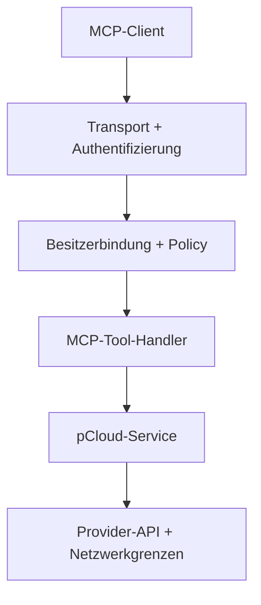

# pcloud-mcp · Produktspezifikation v1.0

**Spezifikationsversion:** 1.0
**Stand:** 2026-10-13
**Status:** Verbindlicher Zielumfang für einen sicheren Lese-MCP.
**Implementierung:** 0.3.0-rc.1; die Freigabe als Software v1.0.0 steht noch aus.

Diese Spezifikation definiert den Produktvertrag. Ihre Version 1.0 ist keine
Behauptung, dass bereits alle Anforderungen implementiert oder abgenommen sind.
Aktueller Betrieb und Nachweise: [README](README.md),
[Testnachweise](docs/verification.md), [Render-Status](docs/render-status.md).

## 1. Produktziel und verbindlicher Umfang

Ein MCP-Server in Go ermöglicht genau einem berechtigten Besitzer, sein eigenes
pCloud-Konto über einen KI-Client kontrolliert zu lesen und zu durchsuchen.
Der erste verbindlich abzunehmende Remote-Client ist **ChatGPT**.

**Software v1.0.0 umfasst:**

- Die fünf Lese-Tools `whoami`, `list_folder`, `get_file_info`, `search_files`
  und `read_text_file`.
- Lokalen stdio-Transport und OAuth-geschütztes Streamable HTTP über HTTPS.
- Feste Besitzerbindung, expliziten Ordnerumfang und serverseitige Policy-Prüfung.
- Konfiguration der pCloud-Region `eu` oder `us` ohne stillen Regionwechsel.
- Reproduzierbare Builds, automatisierte Qualitätsprüfungen, dokumentierten
  Render-Betrieb und eine nachvollziehbare Release-Abnahme.

**Nicht im Umfang von v1.0.0:** Schreiboperationen, Uploads, Bildanalyse,
Bildgenerierung, semantische Bildsuche, öffentliche Freigabelinks, Multi-User-
Hosting sowie Verschieben, Umbenennen, Überschreiben oder Löschen.
Bereits vorhandener optionaler Schreibcode ist eine spätere Erweiterung;
er darf im v1.0-Leseprofil keine Schreib-Tools verfügbar machen.

Claude und weitere MCP-Clients sind mögliche spätere Abnahmen. Kompatibilität
wird ausschließlich für tatsächlich geprüfte Client-/Protokollkombinationen
behauptet. API-basierte Kopier-/Löschabläufe zwischen Cloud-Anbietern gehören
nicht zu diesem Produktumfang.

## 2. Normative Grundlagen und Versionspolitik

- MCP-Spezifikation **2026-07-28**, insbesondere Transport, Tools und Authorization:
  <https://modelcontextprotocol.io/specification/2026-07-28>.
- Offizielles MCP-Go-SDK: <https://github.com/modelcontextprotocol/go-sdk>.
  Implementierungsbaseline ist **v1.8.0**; die gewählte Version wird gepinnt.
- Go-Toolchain-Baseline **1.26.9**; Änderungen müssen Build und Security-Prüfungen
  bestehen und im Release-Nachweis erscheinen.
- pCloud-API- und OAuth-Semantik werden anhand offizieller Primärquellen geprüft:
  <https://docs.pcloud.com/>.
- Die für MCP normativen OAuth-/PKCE-/HTTP-Standards sind einzuhalten.

Die Spezifikationsversion, die Softwareversion und die MCP-Protokollversion sind
getrennt. **Software v1.0.0** wird erst nach der Abnahme in Abschnitt 10 vergeben.
Eine bloße Änderung der Versionszeichenfolge gilt nicht als Release-Freigabe.
Innerhalb der Software-Hauptversion 1 bleiben freigegebene Tool-Namen, Eingabe-
und Ausgabeverträge kompatibel; inkompatible Änderungen benötigen eine neue
Hauptversion oder einen ausdrücklich versionierten Vertrag. Sicherheits-
korrekturen dürfen unsichere Eingaben künftig verweigern und werden dokumentiert.

## 3. Architektur und APIs

Funktionen werden über klar definierte MCP-Tools bereitgestellt. Tool-Handler
rufen keine Provider-HTTP-Endpunkte unmittelbar auf. Authentifizierung,
Autorisierung, Fachlogik und API-Transport sind getrennt und unabhängig testbar.

Die Autorisierung gilt für jede Operation. Ein Modelltext, Dateiname oder
Dateiinhalt darf weder Besitzerbindung noch Ordnerumfang verändern.

## 4. Besitzer, Regionen und Ordnerumfang

- Pro Instanz genau ein positives `PCLOUD_USER_ID` und ein festes OAuth-Subject.
  E-Mail-Adresse oder Client-ID ersetzen die Subject-Bindung nicht.
- Das tatsächliche Provider-Konto muss zur konfigurierten pCloud-Konto-ID passen.
- Die Region ist explizit `eu` oder `us`. Token, Region und Konto-ID dürfen sich
  beim Import eines verschlüsselten Zugangspakets nicht widersprechen.
- EU- und US-Routing benötigen getrennte positive und negative Provider-Tests.
  Die Release-Dokumentation nennt, welche Region real mit einem Konto geprüft
  wurde; eine reale EU-Abnahme ist kein realer US-Nachweis.
- `PCLOUD_ROOT_FOLDER_ID` ist ausdrücklich zu setzen. Eine Unterordner-ID erlaubt
  ausschließlich dessen eigenen Baum. **0 erlaubt die Kontowurzel** und muss eine
  bewusste Betreiberentscheidung sein, kein fehlender-Konfiguration-Default.
- Objekt-ID, Eigentümerschaft und Zugehörigkeit zum erlaubten Baum werden geprüft.
  Fremde, nicht eigene oder außerhalb liegende Objekte sind zu verweigern.
- Umfangsänderungen erfolgen durch Betreiberkonfiguration und Deployment. Die
  Beschreibung im Consent-Flow muss zum freigegebenen Umfang passen.

## 5. Transport und Anmeldung

### Lokal

stdio verwendet gesicherte lokale Credentials. Der konfigurierte Betreiber ist
die lokale Identität. stdout enthält ausschließlich MCP-Protokollnachrichten;
stderr enthält keine Tokens oder Dateiinhalte.

### Remote

- Streamable HTTP ausschließlich über HTTPS; auf Render erfolgt TLS-Terminierung
  am Plattform-Edge. Host-/Origin-/Proxy-Vertrauensgrenzen sind explizit.
- Ein externer Authorization Server übernimmt Anmeldung, Consent, PKCE S256,
  Token-Ausstellung, Refresh und Anbieter-Widerruf.
- Der MCP-Server prüft auf jeder Anfrage Signatur bzw. aktive Introspection,
  exakten Issuer, Resource/Audience, Besitzer-Subject, Ablauf und `files:read`.
- Die Resource-URL ist die tatsächliche HTTPS-MCP-Adresse einschließlich `/mcp`.
  Tokens für andere Ressourcen und reine Provider-Tokens werden verweigert.
- Access-Token-Laufzeit maximal **900 Sekunden ab `iat`**; ungültige, fehlende
  oder unzulässig zukünftige Zeitangaben bleiben abgewiesen.
- JWT-Prüfung und Introspection sind exklusive Konfigurationsmodi. Kein
  stillschweigender Fallback bei einem Prüfungsfehler.
- OAuth Protected Resource Metadata und 401-Auth-Challenge müssen eine echte
  Client-Anmeldung ermöglichen. Redirects und Client-Registrierung sind zu begrenzen.
- Zugangstokens gehören ausschließlich in den Authorization-Header, nicht in URL,
  Logs, Fehlermeldungen oder Tool-Ausgaben.

**Widerrufsvertrag:** Bei lokaler JWT-Prüfung kann ein ausgestellter Token bis
zu seinem Ablauf gültig bleiben, maximal 15 Minuten. Sofortiger Widerruf wird
nicht zugesichert. Refresh, Neuanmeldung, Anbieter-Widerruf und Schlüsselrotation
sind real zu testen und mit ihrer tatsächlichen Wirkung zu dokumentieren.
Bei erforderlichem sofortigem Widerruf ist ein entsprechender Introspection-
Betrieb gesondert abzunehmen. Eigene Refresh-Token-Ausstellung ist kein v1.0-Ziel.

## 6. Lese-Tools und Ressourcenbudgets

Alle Tools gehören zur Risikoklasse **Lesen**. Fehler dürfen keine geheimen
Werte oder Inhalte außerhalb der erlaubten Datenmenge offenlegen.

| Tool | Vertrag | Mindestabnahme |
| --- | --- | --- |
| `whoami` | Verifizierte pCloud-Kontoidentität | Eigenes Konto erfolgreich; falsche Kontobindung verweigert |
| `list_folder` | Eigene Einträge im erlaubten Baum, begrenzte Offset-Seiten | Leer/nicht leer, Pagination, ungültige ID, nicht eigener bzw. außerhalb liegender Ordner |
| `get_file_info` | Metadaten einer eigenen Datei im erlaubten Baum | Eigene Datei erfolgreich; fremde/außerhalb liegende Datei verweigert |
| `search_files` | Begrenzte Suche über Name, relativen Pfad, Endung, verlässlichen MIME-Typ, Größe und Datum | Treffer/kein Treffer, Unterordner, Filter, Budgetabbruch und `truncated` |
| `read_text_file` | Begrenzter UTF-8-Text mit Kennzeichnung als untrusted data | Unterstützter Text erfolgreich; Binär-/NUL-/ungültiger UTF-8-Inhalt und Größenüberschreitung verweigert |

Verbindliche Maximalbudgets des v1.0-Profils:

| Bereich | Grenze |
| --- | --- |
| Ordnerseite | 200 Einträge; Offset höchstens 10.000 |
| Textinhalt | 128 KiB |
| Suchtraversierung | 20 Ordner, Tiefe 8, 2.000 Einträge |
| Zusätzliche Such-Metadatenaufrufe | 100 |
| Suchergebnis | 100 Treffer |
| MCP-Request-Body | Konfiguriert, höchstens 8 MiB |
| JWKS-Antwort im JWT-Modus | 64 KiB |

Pagination ist kein Snapshot. Suchbudgets müssen ein unvollständiges Ergebnis
sichtbar markieren; ein leeres Ergebnis nach Budgetabbruch darf nicht als
vollständige Suche dargestellt werden. Abbruch und Timeouts sind zu beachten.
Keine ungeprüften Download-URLs, keine unbegrenzte Rekursion und keine automatische
Ausführung von Anweisungen aus gelesenen Dateien.

## 7. Security by Design und Geheimnisse

- Default deny, Least Privilege und getrennte Policy-Enforcement-Schichten.
- Stabile Objekt-IDs; Eigentümer-/Baumprüfung und Eingabevalidierung verhindern
  Cross-User-Zugriffe und Traversal.
- Feste Provider-Hostallowlist, TLS-Prüfung, keine unkontrollierten Redirects,
  Schutz gegen SSRF und DNS-Rebinding.
- Explizite Größenlimits, Timeouts, Rate Limits und Parallelitätsgrenzen.
  Health-Probes sind von der MCP-Anfragequote unabhängig.
- pCloud-OAuth-Token und MCP-Zugangstoken sind getrennt. Credentials liegen in
  Umgebungsvariablen oder Secret-Dateien, niemals im Git-Repository oder Image.
- Für gehostetes pCloud-Onboarding: unabhängiges Setup-Secret, browsergebundener
  CSRF-/State-Schutz, kurze Sitzungen, einmalige Callback-Verwendung, geprüfte
  Provider-Identität und verschlüsseltes Zugangspaket mit separatem Schlüssel.
- Das gehostete Setup wird nach Einrichtung abgeschaltet und darf nicht parallel
  zum aktivierten nativen MCP-Leseprofil laufen.
- Falsche Signatur, anderer Issuer/Subject/Audience, fehlender Scope, Ablauf,
  Onboarding-Callback-Replay und Token in URL sind durch geeignete Tests abzudecken.
- Dateiinhalte und Tool-Ergebnisse sind untrusted data; der Server verspricht
  keine vollständige Prompt-Injection-Abwehr im angeschlossenen Modell.
- Sicherheitsgrenzen und verbleibende Risiken sind offen zu dokumentieren.

## 8. Deployment, Betrieb und Barrierefreiheit

- 12-Factor-Konfiguration, gepinnte Abhängigkeiten, reproduzierbarer Build und
  geordneter Shutdown; Container als alternative Betriebsform.
- Verbindlicher Erstbetrieb: **ein bestehender Render-Web-Service, Frankfurt,
  Free bevorzugt**. Keine kostenpflichtige Ressource ohne ausdrückliche Zustimmung.
- GitHub Actions prüft Build, Tests und Security. **Render deployt erst nach
  erfolgreichen CI-Prüfungen**, mit eingerichtetem Plattform-Healthcheck `/healthz`.
- Health zeigt Prozessbereitschaft ohne Credentials oder Dateiinhalte. Vor Öffnung
  des nativen Remote-Listeners sind Provider-Konto und Stammordner lesend zu prüfen.
- Deployment-Konfiguration, tatsächliche Service-URL, Commit, Deployment-ID,
  Testergebnisse, Rückweg zur sicheren Konfiguration und Betriebsgrenzen werden dokumentiert.
- Free-Kaltstarts und fehlende Verfügbarkeitsgarantie sind kenntlich zu machen.
- Versionierte APIs, verständliche Fehlermeldungen und barrierefreie Dokumentation.
  Einrichtungsoberflächen haben semantische Beschriftungen, Tastaturbedienbarkeit,
  verständliche Fehler und eine nutzbare mobile Darstellung.

## 9. Entwicklung und Qualitätssicherung

TDD gilt für Domain-, Policy-, API- und kritische Authentifizierungslogik.
Sicherheitsregeln benötigen gezielte Mutationstests; Parser und Netzwerkgrenzen
werden zusätzlich mit Go-Fuzzing geprüft.

Pflichtprüfungen: Build, Unit-/Integrations-/MCP-Protokolltests, Race Detector,
`go vet`, Format-/Modulprüfung, `govulncheck`, Secret-Scan der Git-Historie sowie
reproduzierbare Deployment-Prüfung. Ein Testfund darf nur nach Prüfung als
Fehlalarm eng begrenzt ausgenommen werden; keine pauschale Abschaltung des Scanners.

Die Testmatrix umfasst erfolgreiche Zugriffe, Owner-/Ordnergrenzen, leere
Ergebnisse, Pagination, Filter, ungültige Eingaben, Limits einschließlich Grenze
+1, Abbruch, Provider-Fehler und Token-/Origin-/SSRF-Negativfälle. Automatisierte
Tests und reale Client-Abnahmen sind getrennt auszuweisen.

## 10. Release-Gate für Software v1.0.0

**Alle folgenden Kriterien sind vor einem Software-v1.0.0-Release zu erfüllen.**
Ein Status „offen“ blockiert die Freigabe. Die Tabelle beschreibt den bekannten
Stand bei Festlegung der SPEC v1.0; Fortschritte werden im Testnachweis gepflegt.

| ID | Akzeptanzkriterium | Bekannter Stand am 13.10.2026 |
| --- | --- | --- |
| R1 | Genau die fünf Lese-Tools im freigegebenen Profil; keine verfügbare Schreiboperation | Gehostet erfüllt; gesamtes Release-Profil noch abschließend prüfen |
| R2 | Reales ChatGPT-Login, `whoami`, Ordnerliste und Dateimetadaten erfolgreich | Erfüllt |
| R3 | Reale Suche und Textlesen mit positiven/negativen Fällen nach Abschnitt 6 | Offen |
| R4 | Pagination, Such-/Textbudgets und unvollständige Ergebnisse geprüft | Automatisierte Tests vorhanden; reale vollständige Matrix offen |
| R5 | Unterordnerbegrenzung, explizite Root-Freigabe und Owner-Grenzen nachgewiesen | Reale Unterordner-/Root-Fälle und automatisierte Owner-Tests vorhanden |
| R6 | Ablauf, Refresh, erneute Anmeldung, Widerrufsvertrag und Schlüsselrotation real geprüft | Offen |
| R7 | EU/US-Routing mit Provider-Fixtures geprüft; reale Regionalabnahme klar ausgewiesen | EU real geprüft; regionale Gesamtmatrix abschließend prüfen |
| R8 | Alle Pflichtprüfungen auf exakt dem Release-Commit erfolgreich, keine ungeklärten Security-Funde | Erfolgreiche CI für frühere Implementierung; Release-Commit noch nicht erstellt |
| R9 | Render wartet auf CI; Plattform-Healthcheck und sichere Rückkonfiguration geprüft | Offen |
| R10 | Einrichtungsablauf inklusive mobiler Bedienung und Geheimnisübernahme abgenommen | Grundablauf real erfolgreich; mobile vollständige Abnahme offen |
| R11 | README, SPEC, Konfiguration und reale Ergebnisse widerspruchsfrei; Risiken und Clientgrenzen dokumentiert | Vorhanden; finale Release-Prüfung offen |
| R12 | Softwareversion 1.0.0, Git-Tag `v1.0.0`, Release Notes mit Commit/Deployment/Abnahme | Offen; nicht durch SPEC-Versionsänderung erledigt |

Der Release-Nachweis benennt konkret getestete Clients und Regionen. Ungetestete
Kombinationen erhalten keinen pauschalen Kompatibilitäts- oder Produktionsnachweis.

## 11. Roadmap nach dem Lese-Release

| Etappe | Geplanter Umfang | Eigenständige Freigabebedingung |
| --- | --- | --- |
| Reversible Änderungen | Ordner erstellen, kopieren, Upload und Artefaktspeicherung | Schreibscope, serverseitige Policy, Audit, Integrität, Konflikt-/Überschreibschutz und reale Client-Abnahme |
| Verschieben und Umbenennen | Kontrollierte Änderungen eigener Objekte | Ziel-/Zustandsprüfung, Vorschau und Tests konkurrierender Änderungen |
| Destruktive Operationen | Überschreiben und Löschen | Separate Policy, explizite überprüfbare Nutzerbestätigung, erneute Vorbedingungsprüfung und nachvollziehbares Audit |
| Weitere Clients | Claude und weitere MCP-Clients | Jeweils reale Anmeldung, Protokoll- und Tool-Abnahme |
| Erweiterter Betrieb | Multi-User, zusätzliche Integrationen oder Infrastruktur | Separates Identitäts-/Credential-/Audit-Isolationskonzept und eigene SPEC-Erweiterung |

Für Uploads ist die tatsächliche Binärübergabe des jeweiligen Clients separat
nachzuweisen; keine universelle automatische ChatGPT-/Claude-Artefaktübergabe.
Dateien sortieren ist eine überprüfbare Folge einzelner Operationen, kein
unkontrolliertes Massen-Tool. Fehlt ein wirksamer Bestätigungsmechanismus für eine
destruktive Aktion, wird sie verweigert. Eine spätere SPEC-Erweiterung ändert
keine bestehenden Zugriffsrechte ohne ausdrückliche Betreiberentscheidung.

## 12. Optionale Video-Vorschau außerhalb des v1.0-Standardprofils

Auf Betreiberwunsch vom 2026-10-13 wird eine additive, opt-in Lese-Erweiterung
`get_video_frames` implementiert. Sie verändert den Fünf-Tool-Vertrag und die
Freigabekriterien für das Standardprofil nicht. `PCLOUD_ENABLE_VIDEO` ist
standardmäßig false. Ein erweitertes Profil liefert sechs Lese-Tools und muss
separat als solches benannt und getestet werden.

Der Eingabevertrag ist `{file_id, seconds}`; ein bis vier streng aufsteigende,
endliche Zeitpositionen zwischen 0 und 600 Sekunden. Ausgabe sind markierte,
nicht vertrauenswürdige JPEG-Bildinhalte mit angeforderten, approximativen
Zeitpositionen, keine automatische Tanzklassifikation. Metadaten enthalten
keine privaten Downloadlinks oder Tokens. Nur eigene MP4/MOV/WebM-Dateien im
freigegebenen Baum mit passendem MIME-Typ und maximal 128 MiB sind zulässig.
Besitzer- und Dateiumfang werden vor dem Download geprüft; Dateiversion und
Umfang werden anschließend erneut geprüft. Dies ist keine Provider-Snapshot-
oder Sperrgarantie.

Downloads verwenden intern ausschließlich validierte HTTPS-Hosts unter
`.pcloud.com`, keine Redirects und das vorhandene Public-IP/DNS-Enforcement.
Private temporäre Dateien werden nach jedem Ergebnis entfernt. Extraktion
läuft einzeln, ohne geerbte Secrets, ohne Netzwerkprotokolle, mit Zeit-, CPU-,
Adressraum- und Ausgabelimits. Vier Bilder zu maximal 128 KiB, maximal 640×360.
Medien-Decoder müssen gepatcht werden; Prozesslimits sind keine vollständige
Betriebssystem-Sandbox. Details und Nachweis: [Video-Vorschau](docs/video-preview.md).
